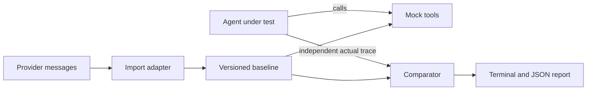

# agent-replay

Offline regression tests for AI agent tool calls.

  

<!-- GIF placeholder: add a terminal demo after recording one. -->

## Quick start

Requires Python 3.11+ and [uv](https://docs.astral.sh/uv/). From this directory:

```sh
uv sync --all-groups
uv run pytest --cov=agent_replay --cov-report=term-missing
uv run python examples/mock_agent.py
uv run agent-replay compare examples/traces/booking.json examples/traces/booking-broken.json --json-report report.json
```

The last command intentionally exits 1. An editable local installation is `python -m pip install -e .`. If this package is published under its proposed name, `pip install agent-replay` will be the install command; it is not published by this project yet. The name returned 404 on PyPI on 2026-11-10 and is not reserved. Similar projects already exist, including [Reflight](https://github.com/pauti04/reflight), which instruments and replays agent runs, and [AgentReplay](https://github.com/agentreplay/agentreplay), which covers tracing, observability, and evaluations. This project is not affiliated with them.

## Troubleshooting imports on macOS

If `uv run` reports `ModuleNotFoundError: No module named agent_replay` after installation, some file-management tools may have marked the editable-install path file as hidden. Python skips hidden `.pth` files. Inspect flags with `ls -lO .venv/lib/python*/site-packages/*.pth`; avoid applying the hidden flag recursively to `.venv`. A temporary local workaround is to link the package into the virtual environment: `uv run python -c 'import pathlib,sysconfig; p=pathlib.Path(sysconfig.get_path("purelib"))/"agent_replay"; p.symlink_to(pathlib.Path.cwd()/"src/agent_replay", target_is_directory=True)'`. Run it from the project root, and only if that link does not already exist.

## What it checks

Compare a baseline against a **newly observed** trace to identify changed tool names, arguments, order, results, errors, and timestamps. Comparing two stored traces checks only their contents; it does not run an agent. `MockTools` lets an agent under test make calls against recorded outcomes while validating JSON Schemas, call order, arguments and completion. Assert the agent's own response to recorded failures to test error handling; the mock cannot infer whether the agent handled an exception correctly. No network call, tool, shell command, or executable code is invoked from a trace. The agent itself is caller-controlled code.

Each JSON trace has `schema_version: 1` and a `steps` array. Each step has `tool`, `arguments`, `result`, `error`, and `timestamp` (ISO 8601 or null); result and error cannot both be non-null. Input validation supplies null defaults for omitted outcomes and timestamps. JSON arguments and results may include nested JSON values. Protect private data: traces can contain secrets; all included examples are synthetic.

Strict compares values and object key order, including nested arguments, and treats booleans and numbers as different. Loose ignores object key order and keys named by repeatable `--ignore` at any nesting level, including trace fields. Extra keys in arguments only are allowed if their key names are passed with repeatable `--optional`; these names apply at every argument nesting level. Missing expected keys remain failures. List order and all other values remain exact. These options are ignored in strict mode. Be careful: broad key names may hide meaningful differences.

`--json-report report.json` writes a machine-readable object containing a `differences` array. Exit status is 0 for match, 1 for regression, 2 for bad input. Terminal differences are colored when supported. Use `uv run agent-replay compare BASELINE ACTUAL --loose --ignore timestamp --optional request_id`.

## Agent and pytest integration

`tests/test_example.py` demonstrates `@agent_replay.trace("examples/traces/booking.json")`: the decorated test **returns the actual Trace**, supplied independently by the test. Replace the example's constructed Trace with one produced by your agent's tool-call hook; the decorator compares it to the baseline. Pytest fixtures may be parameters of the decorated test. `examples/mock_agent.py` shows a separate executable mock-based test and explicitly asserts handling of a tool error. MockTools checks names against the supplied schema registry; every schema is a JSON Schema Draft 2020-12 object, and strict call matching always applies. Call `finish()` to detect missing calls. It does not automatically intercept an SDK or observe arbitrary Python code.

## Import formats

`uv run agent-replay import openai messages.json trace.json` or replace `openai` with `anthropic`. Input is a **JSON array of complete conversation messages**, not a provider API response envelope, streaming deltas, or Responses API items. Calls require corresponding results, matched by ID, and retain call order. Timestamps are null. Duplicate pending IDs, malformed calls, and missing/unmatched results fail.

* OpenAI Chat Completions subset: assistant messages with `tool_calls` containing `id`, `type: "function"`, and `function` with `name` and JSON-object string `arguments`; subsequent `role: "tool"` messages contain matching `tool_call_id` and string `content`. Tool content is stored as a string, not parsed as JSON. OpenAI tool messages do not carry a standardized error marker in this subset; they import as results. Plain user/system/developer/assistant messages are ignored.
* Anthropic Messages subset: assistant `content` blocks with `type: "tool_use"`, `id`, `name`, object `input`; user blocks with `type: "tool_result"`, `tool_use_id`, string `content`, and optional `is_error`. Text blocks and string content are ignored. Other block types and non-string tool results are unsupported.

Provider formats are described in [OpenAI function calling](https://platform.openai.com/docs/guides/function-calling) and [Anthropic tool use](https://platform.claude.com/docs/en/agents-and-tools/tool-use/overview). This custom format is not an OpenTelemetry format; [OpenTelemetry GenAI semantic conventions](https://opentelemetry.io/docs/specs/semconv/gen-ai/) describe telemetry rather than guaranteeing compatibility with this project's traces.



## Development and release

See [CONTRIBUTING.md](CONTRIBUTING.md). CI checks lint, types, tests and build. A tag triggers the release workflow only after a repository and PyPI trusted publisher have been configured; use PyPI's trusted publishing configuration for the repository owner, repository name, workflow `release.yml`, and `pypi` environment. Configure that GitHub environment and protect releases as appropriate. Check distribution-name availability again immediately before release. Nothing has been published.

## Limitations and roadmap

No live recording, SDK interception, streaming, real tool execution, semantic equivalence, nondeterministic matching, or OpenTelemetry export. Schema checks apply to mock calls, not arbitrary trace comparisons. Stored error fields do not establish that an agent recovered; test its behavior. Adapters intentionally support only the subsets above. See [BACKLOG.md](BACKLOG.md) for deferred recording, integrations, viewer, and cost tracking.
